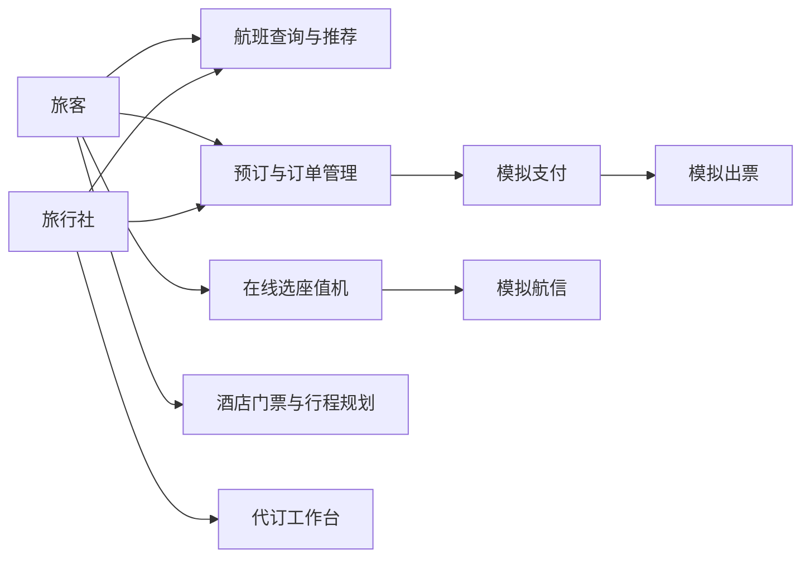
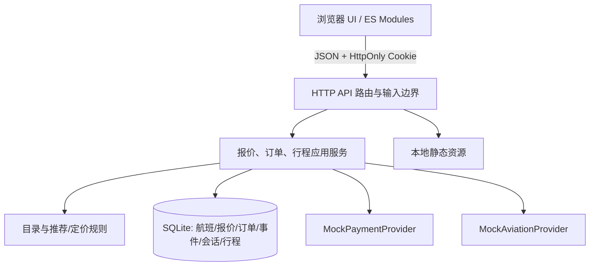
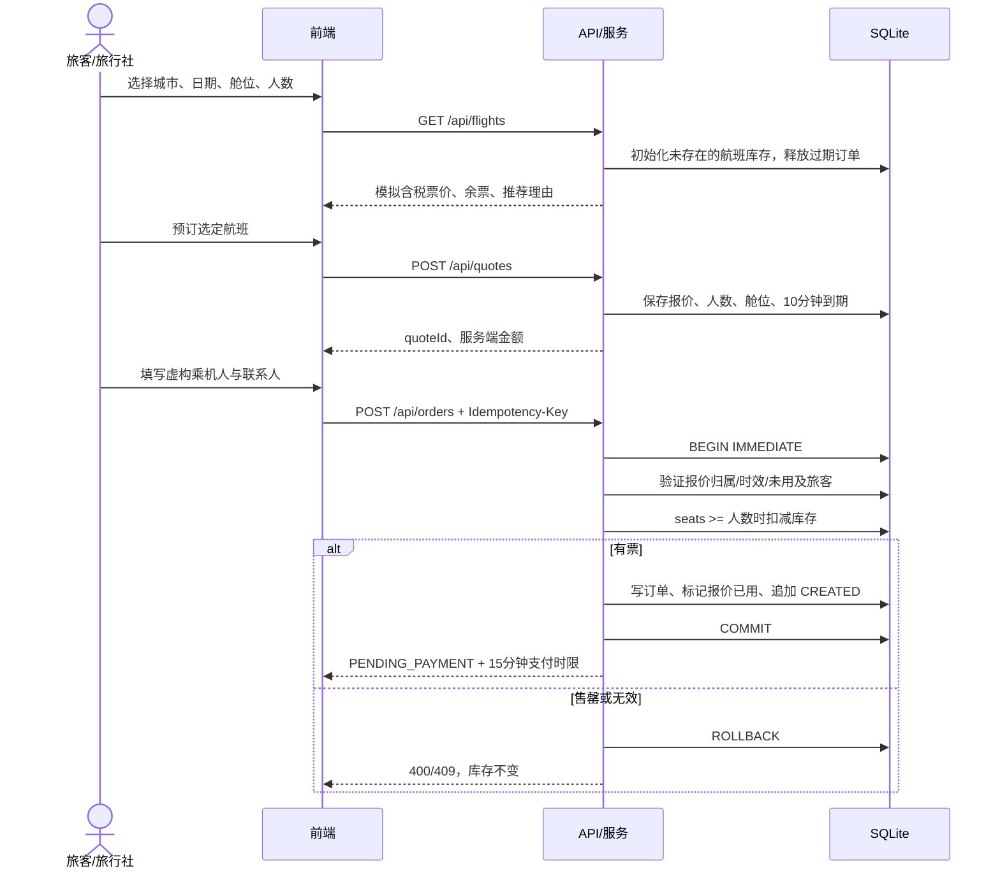
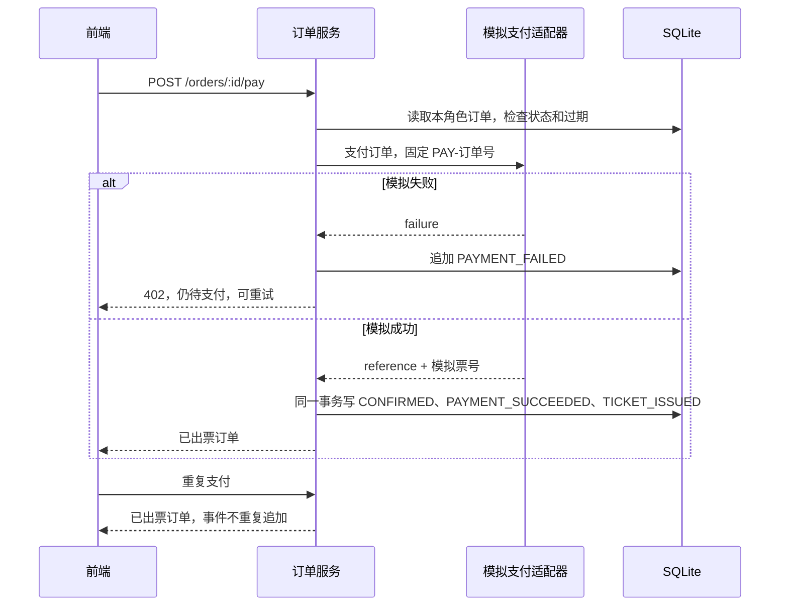
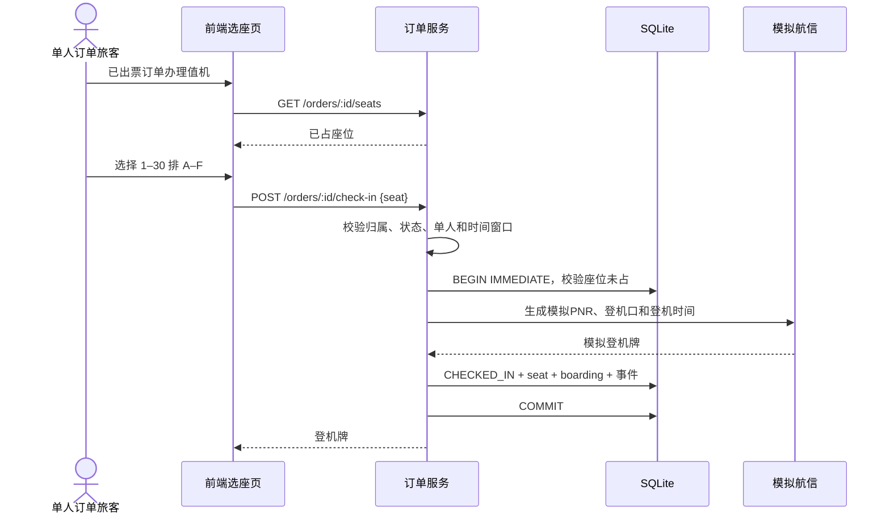
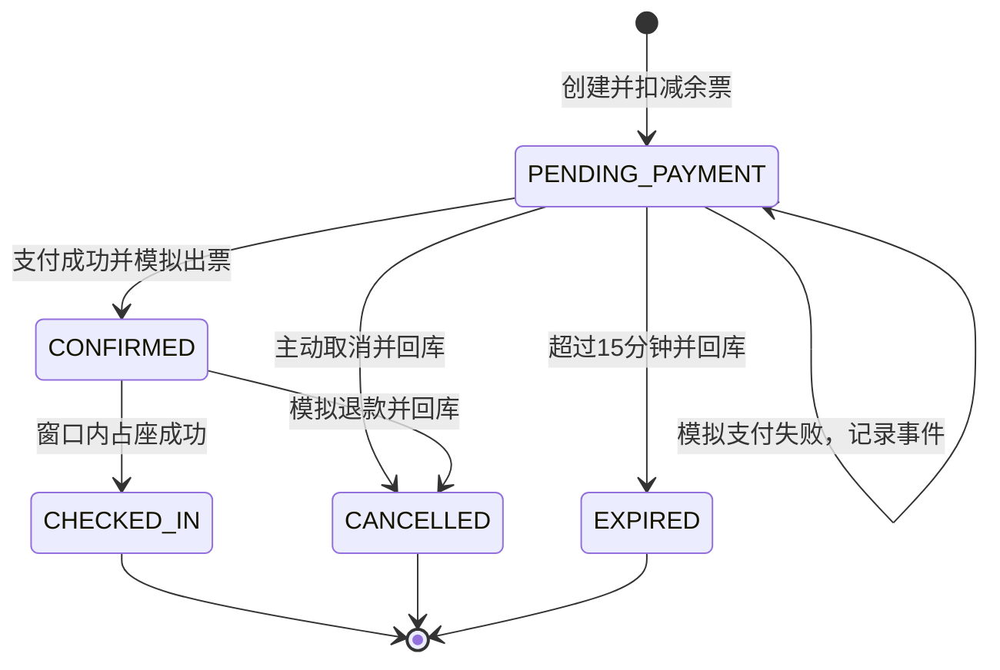
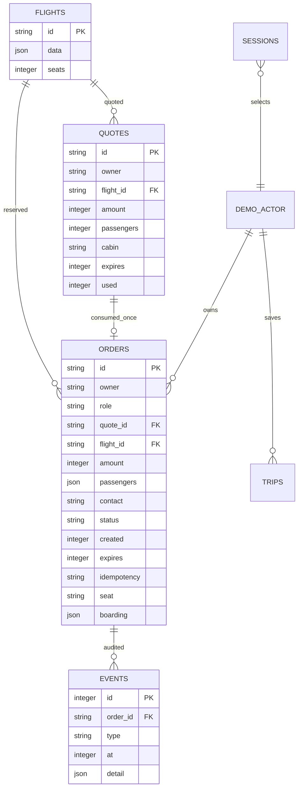

# 需求分析与系统设计

## 目标与实现范围

项目为“航空旅行一站式服务平台”课程实现。核心验收是实际运行的航班搜索、用户订单页面、后端接口，以及查询到订单创建的完整链路；在此基础上提供模拟支付、出票、选座值机和地面行程规划。

携程公开页面用于分析导航分组、搜索字段、推荐模块和信息呈现。后端架构、数据库和状态规则属于本项目设计，没有声称还原携程服务端。

## 多角色用例

| 角色 | 用例 | 前置条件 | 成功结果 | 主要异常 |
|---|---|---|---|---|
| 旅客 | 查询与筛选航班 | 选择不同城市与今天起 180 天内日期 | 获得含税价格、余票、时刻与推荐理由 | 无效日期、同城、无匹配航班 |
| 旅客 | 预订机票 | 选择航班、1–6 人 | 10 分钟报价后创建待支付订单，扣减库存 | 报价失效、人数不匹配、资料错误、售罄 |
| 旅客 | 支付与出票 | 订单待支付且未过期 | 支付成功事件和模拟出票事件，订单已出票 | 模拟失败、过期、非法状态 |
| 旅客 | 管理订单 | 演示角色已选定 | 按状态查看、本角色订单详情、取消 | 其他角色订单不可见；已值机不可取消 |
| 旅客 | 在线值机 | 单人订单已出票，处于时间窗口 | 原子占座与模拟登机牌 | 座位已占、窗口未开、非单人订单 |
| 旅客 | 酒店/门票查询与行程规划 | 选择目的地、天数、预算 | 生成保存行程、预算与文本下载 | 未收录内容、预算不足、天数非法 |
| 旅行社 | 代订与管理 | 切换旅行社演示角色 | 订单记录带 agency，工作台汇总本角色数据 | 无权限查看其他角色订单 |
| 模拟支付提供者 | 支付成功/失败 | 请求当前待支付订单 | 固定交易号与可重复读取的状态 | 显式失败返回 402，状态保持待支付 |
| 模拟航信提供者 | 出票与值机 | 支付成功/已出票 | 模拟票号、PNR、座位、登机口 | 状态与座位校验失败 |



## 前后端分离架构

前端使用 HTML、CSS、浏览器 ES Modules；后端使用 Node HTTP 与内置 SQLite。它们通过 `/api/` JSON 契约通信，可独立替换前端或路由层。目前由同一进程提供静态文件与 API，保持同源，减少本地启动依赖。



职责边界：

- `catalog.mjs` 拥有城市、时刻和目录数据；服务使用解析后的城市对象。
- `service.mjs` 拥有报价、状态转换、授权范围、价格和行程规则。前端不能指定最终成交金额。
- `store.mjs` 拥有事务与事件追加。所有库存扣减和对应订单创建位于同一事务。
- `server.mjs` 拥有 HTTP 输入、会话 Cookie、错误响应、同源写入边界及静态文件目录限制。
- `frontend/app.js` 拥有页面导航、用户输入与结果渲染；服务端校验不依赖浏览器校验。

## 航班搜索、推荐与动态票价

支持上海、北京、广州、深圳、成都、杭州、三亚、西安。每个方向和日期生成 5 班时刻，再保存为模拟库存。搜索忽略已起飞或 45 分钟内起飞的航班。

价格以人民币整数元保存：

```text
经济舱含税价 = round(基础价 + 临近出发调整 + 5分钟需求扰动) + 80
商务舱含税价 = round((基础价 + 临近出发调整 + 5分钟需求扰动) × 2.6) + 80
临近调整：不足3天 +120；不足14天 +40；其他 +0
需求扰动：由 航班ID+5分钟时间桶 的确定性哈希得到 [-30,+30]
推荐分数 = round(100 - 含税价/50 - 时长分钟/30 - 早晚出发惩罚)
早晚惩罚：08:00前或22:00后出发扣5分
```

这是一套可复现、可解释的规则算法。未使用机器学习模型、真实票价历史或实际航空库存。低价日期栏按模拟日历价推导，不承诺每个日期或时段都有余票。

## 查询到订单创建的关键序列



同一角色与同一 `Idempotency-Key` 重放相同请求返回同一订单；同键不同报价或旅客/联系人返回冲突。已使用报价不能用新键再买一单。最终金额来自服务端报价，客户端传入 `amount` 不参与结算。

## 支付、出票与失败处理



当前支付提供者没有网络和异步回调，出票与支付在本地事务中同步完成。取消待支付订单或已出票订单会释放库存；已付款取消追加全额模拟退款金额；重复取消不再次回库。失败支付日志也持久保存。

## 值机序列



数据库对同一航班的已值机座位设唯一索引，服务还在事务中先做冲突校验。重复提交同一座位返回已有结果；试图更换已完成值机的座位会被拒绝。多人订单可以创建和支付，逐人多人值机尚未实现。

## 订单状态机



过期清理在相关查询/写入入口执行，属于请求触发的惰性清理，没有后台调度器。无人访问时页面倒计时可能已经结束，而库内状态要到下一次相关请求才更新；任何后续支付/下单都会再次检查，过期订单不能继续成交。

## 数据模型



`DEMO_ACTOR` 是逻辑角色，不是实际用户表。会话映射到两个固定示例身份；真实系统应替换为独立用户、旅行社组织成员及被代订旅客的授权关系。索引覆盖订单归属与时间排序、角色+幂等键唯一约束、报价单次消耗和航班座位唯一约束。

## 酒店、门票与行程

目录收录 6 个模拟酒店和 6 个模拟景点。行程按目的地、1–7 天和预算生成：首日安排已收录收费景点一次，后续以通用免费街区/公园活动衔接，最后一天预留返程时间。住宿按 `天数-1` 晚，未收录酒店的城市使用明确的 350 元/晚假设；餐饮交通按 150 元/天。

这不是地图导航或真实营业时间校验；未计算航班费用、具体交通路网、预约剩余量和季节性开放。酒店/门票与机票仅在规划体验层聚合，未实现跨品类交易与联合订单。

## 外部模拟 API 到真实 API 的集成规划

| 边界 | 当前实现 | 替换真实服务时的设计 |
|---|---|---|
| 支付 | 本地函数同步成功/失败；固定交易号 | 新增 PaymentIntent 与支付流水；签名校验回调；以商户订单号和网关流水号幂等；只允许有效状态转移；金额/币种核对；定时对账 |
| 航信出票 | 支付成功后同步生成模拟票号 | 拆分已支付与出票中/出票成功/失败状态；Outbox 异步出票；超时重试、人工介入与退款补偿 |
| 航班库存 | SQLite 条件扣减 | 外部航班查询与锁座 token；超时释放、库存版本与分布式事务补偿 |
| 值机 | 单人座位唯一索引、模拟 PNR | 航司窗口与旅客级票联状态；航司座位图版本；幂等值机请求、撤销与冲突刷新 |
| 地面服务 | 本地目录与规则规划 | 独立酒店/景点供应商接口、真实价格与预约；聚合计划但各交易保持清晰的主单/子单归属 |

这些是真实集成的设计方案，当前没有对接或验证任何支付、航信或携程内部 API。
